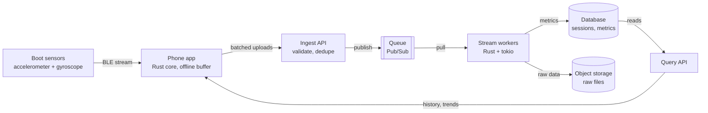

# <Service name>: design

## Goal

<One or two sentences restating what the service must do, in the prompt's terms.>

## Assumptions

Adapt or delete rows; state any number the prompt doesn't give as an assumption.

| Assumption | Value | Why it matters |
| --- | --- | --- |
| Active devices or users at peak | <e.g. 100,000> | Sizes ingest, queue and workers |
| Data rate per device | <e.g. 2.4 KB/s> | Sizes bandwidth and storage |
| How fresh results must be | <e.g. summary within 60 s> | Stream processing or batch |
| Offline behaviour | <e.g. uploads arrive hours late> | Buffering, ordering, duplicates |
| Retention | <e.g. raw data 1 year, metrics forever> | Storage tiers and cost |

## Sizing

<Back-of-envelope math, for example: 2 sensors × 6 axes × 100 Hz × 2 bytes ≈ 2.4 KB/s per device, about 50 MB per six-hour day before compression. 100,000 devices × 50 MB ≈ 5 TB of raw data a day. If each uploads one day of data spread over 8 hours, that's about 210 uploads a minute, roughly 3.5 a second.>

## Architecture

Text version (renders on GitHub and at mermaid.live):

## Data flow, hop by hop

1. **Device to API:** <protocol, batch size, compression, auth, retry with backoff>
2. **API to queue:** <validation, idempotency key such as session ID + chunk number>
3. **Queue to workers:** <ordering, partitioning by session, retries, dead-letter queue>
4. **Workers to storage:** <what is written where, and when>
5. **Storage to app:** <query patterns, caching, how fresh the reads are>

## Backpressure and failure modes

Adapt or delete rows to match your design.

| Hop | If it is slow or down | What happens |
| --- | --- | --- |
| Device to API | API slow or unreachable | Device keeps buffering locally and retries with backoff |
| API to queue | Queue unavailable | API returns 503 or 429; clients retry later |
| Queue to workers | Workers fall behind | Backlog grows in the queue; scale workers on backlog size |
| Workers to database | Database slow | Bounded worker concurrency slows consumption; the queue absorbs the rest |
| Poison message | A message keeps failing | After N attempts it moves to a dead-letter queue for inspection |

## Storage and serving

<Raw versus derived data, hot versus cold storage, and the queries the app actually makes.>

## Tradeoffs and next steps

- <What changes at 10 times the load>
- <What to monitor: queue backlog, error rate, end-to-end latency>
- <What to build second>
